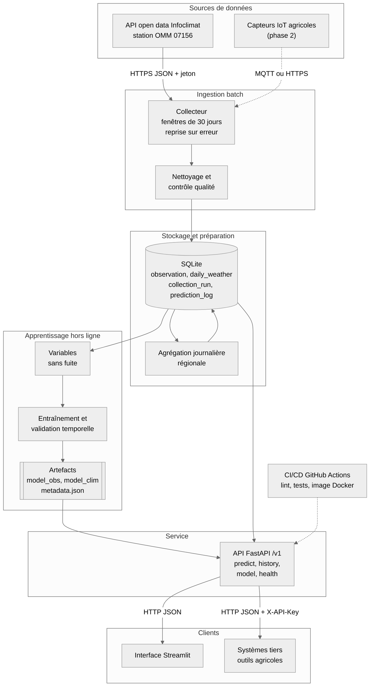
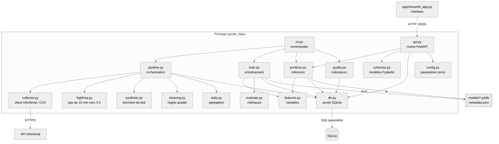

# Architecture

## Diagramme d'architecture

## Diagramme de composants

Images : `docs/img/architecture.png` et `docs/img/components.png` (sources Mermaid dans `docs/diagrams/`).

## Principes
- Le traitement par lots (collecte, nettoyage, entraînement) est séparé du service d'inférence (API).
- Une collecte rejouée met à jour la base sans créer de doublons.
- Cinq variables seulement, un modèle léger, SQLite sans serveur.
- Le schéma est portable vers PostgreSQL ; les capteurs IoT s'ajoutent en amont du collecteur.
