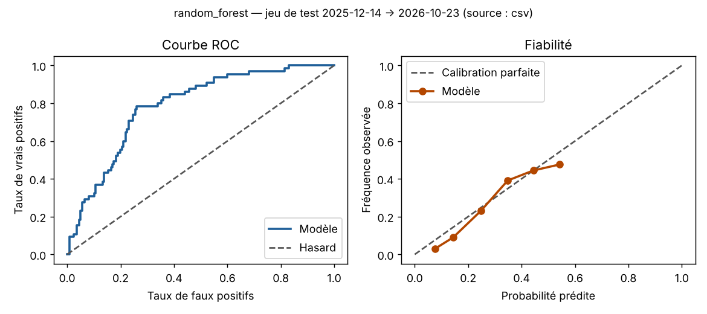

# Évaluation du modèle

- Version : `20261112-a8945bca` — source des données : **csv**
- Période de test : 2025-12-14 → 2026-10-23

| Modèle | ROC-AUC | PR-AUC | Brier | Exactitude | Précision | Rappel | F1 |
|---|---|---|---|---|---|---|---|
| Modèle retenu (random_forest), seuil 0,5 | 0.7855 | 0.4457 | 0.1387 | 0.7885 | 0.4762 | 0.1538 | 0.2326 |
| Modèle retenu, seuil d'alerte 0.26 (choisi par validation croisée) | 0.7855 | 0.4457 | 0.1387 | 0.7436 | 0.4359 | 0.7846 | 0.5604 |
| Référence : climatologie | 0.6656 | 0.3368 | 0.1654 | 0.7917 | 0.0 | 0.0 | 0.0 |
| Référence : persistance | 0.6308 | 0.2943 | 0.2436 | 0.7564 | 0.4154 | 0.4154 | 0.4154 |
| Référence : fréquence moyenne | 0.5 | 0.2083 | 0.1684 | 0.7917 | 0.0 | 0.0 | 0.0 |

Score de Brier relatif à la climatologie (BSS) : **0.1614** (> 0 = le modèle bat la climatologie).

